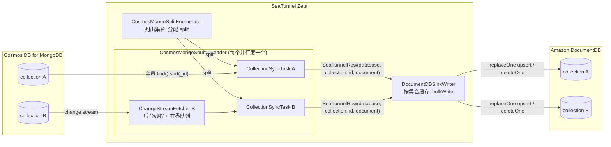
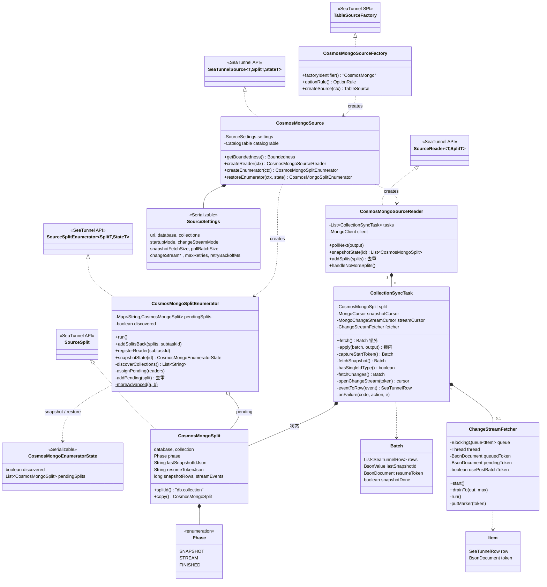
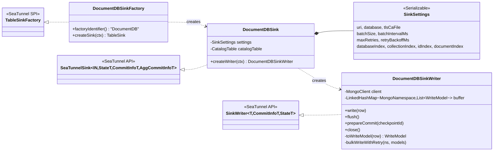
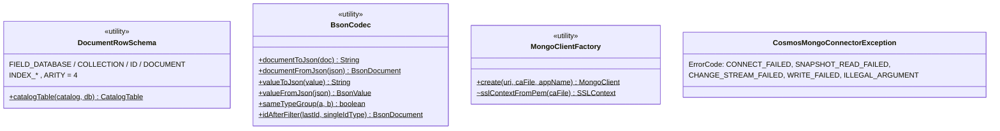
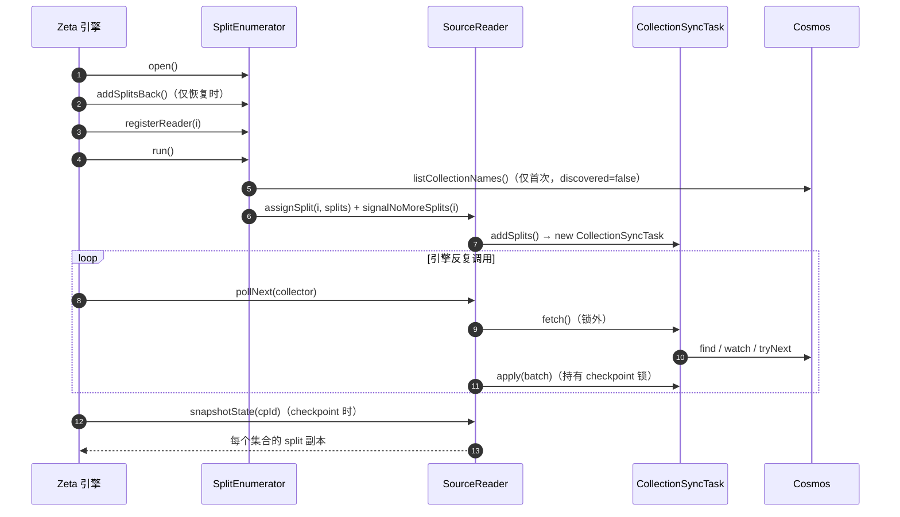
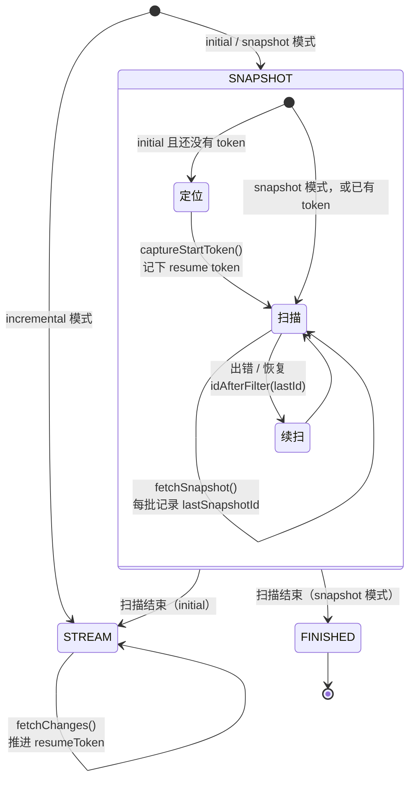
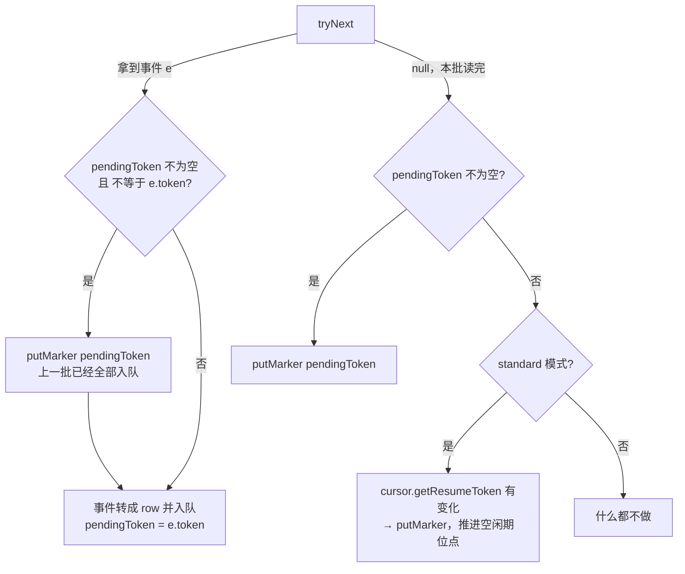
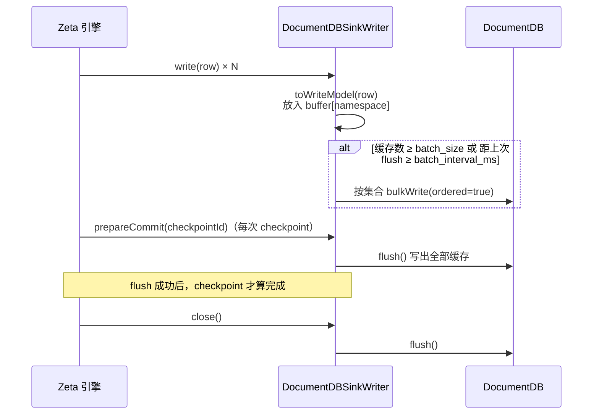

# connector-cosmos-mongodb 开发者文档

本文面向后续维护和二次开发这个插件的开发者，说明设计思路、代码结构、关键机制，以及开发过程中踩过的坑和对应的修改。部署和使用请看 [操作手册.md](操作手册.md)。

- 适用版本：Apache SeaTunnel 3.0.0（Zeta 引擎），MongoDB Java Driver 4.11.5
- 源码路径：`src/main/java/org/apache/seatunnel/connectors/seatunnel/cosmosmongo/`
- 代码规模：21 个类，约 2650 行（不含测试）

---

## 目录

1. [需求与背景](#1-需求与背景)
2. [总体设计](#2-总体设计)
3. [代码结构](#3-代码结构)
4. [类图](#4-类图)
5. [Source 设计详解](#5-source-设计详解)
6. [Sink 设计详解](#6-sink-设计详解)
7. [一致性与容错](#7-一致性与容错)
8. [Cosmos DB 的特殊行为及应对](#8-cosmos-db-的特殊行为及应对)
9. [SeaTunnel 引擎的特殊行为及应对](#9-seatunnel-引擎的特殊行为及应对)
10. [开发过程中的修改记录](#10-开发过程中的修改记录)
11. [测试](#11-测试)
12. [二次开发指南](#12-二次开发指南)
13. [已知限制与待办](#13-已知限制与待办)

---

## 1. 需求与背景

### 1.1 需求

把 Azure Cosmos DB for MongoDB 的数据同步到 Amazon DocumentDB，要求：

- 支持**全量**同步；
- 支持**增量**同步，增量基于 change stream（Cosmos 里叫 change feed）；
- 作为 Apache SeaTunnel 插件运行。

### 1.2 为什么不用现成的 connector

SeaTunnel 3.0.0 自带了几个相关的 connector，调研后发现都不满足需求：

| 现有 connector | 不满足的原因 |
|---|---|
| `connector-azurecosmosdb` | 使用的是 Cosmos **NoSQL** API（azure-cosmos SDK），不是 MongoDB API |
| `connector-amazondocumentdb` | 只有 Source，没有 Sink；不支持 change stream |
| `connector-mongodb` | Source 只能全量；Sink 需要固定 schema，并且一次只能写一个集合 |
| `connector-cdc-mongodb` | 基于 Debezium / Flink CDC，依赖标准的 change stream 行为（`operationType`、`startAtOperationTime` 等），Cosmos RU 不满足 |

### 1.3 Cosmos DB for MongoDB 的两种架构

| | RU 架构 | vCore 架构（现名 Azure DocumentDB） |
|---|---|---|
| change stream 管道 | 必须使用固定的 `$match` + `$project` + `fullDocument: updateLookup` | 标准 MongoDB 管道 |
| `operationType` | **不返回** | 返回 |
| delete 事件 | **不支持** | 支持 |

插件通过 `change_stream.mode` 参数同时支持这两种架构：`cosmos_ru` 对应 RU，`standard` 对应 vCore 或原生 MongoDB。

---

## 2. 总体设计

### 2.1 设计原则

1. **一个集合对应一个 split**：一个集合在任何时刻只由一个 reader 读取，这样同一文档的事件顺序在整条链路上都能保持，sink 端不需要处理乱序。
2. **schema-less 行格式**：不为每个集合推断 schema，文档整体以 canonical Extended JSON 字符串传递。这样 BSON 类型无损，一个作业也能同步整个库。
3. **写入幂等**：sink 只做按 `_id` 的整文档 `replaceOne(upsert)` 和 `deleteOne`。因此"回放""重试""重复读"都是安全的，这是整个一致性方案的基础（见第 7 节）。
4. **位点先于数据**：`initial` 模式下，先记录 change stream 位点，再做全量。
5. **网络 IO 不持有 checkpoint 锁**：读数据（可能阻塞或 sleep）在锁外完成；"发出数据 + 推进位点"在锁内原子完成。

### 2.2 数据流



### 2.3 行格式（Source 和 Sink 之间的约定）

定义在 `common/DocumentRowSchema.java`：

| 序号 | 字段 | 类型 | 说明 |
|---|---|---|---|
| 0 | `database` | STRING | 源库名 |
| 1 | `collection` | STRING | 源集合名 |
| 2 | `id` | STRING | `_id` 的 canonical Extended JSON，例如 `{"$oid": "..."}`、`"user-1"`、`{"$numberLong": "42"}` |
| 3 | `document` | STRING | 整个文档的 canonical Extended JSON；delete 事件时为 null |

`RowKind` 的含义：

| RowKind | 产生场景 | Sink 动作 |
|---|---|---|
| `INSERT` | 全量文档；standard 模式的 insert 事件 | `replaceOne(_id, doc, upsert)` |
| `UPDATE_AFTER` | cosmos_ru 模式的所有事件；standard 模式的 update / replace 事件 | `replaceOne(_id, doc, upsert)` |
| `DELETE` | standard 模式的 delete 事件 | `deleteOne(_id)` |
| `UPDATE_BEFORE` | 不会产生 | 忽略 |

为什么用 **canonical** Extended JSON，而不是 relaxed：relaxed 模式会把 `Int64` 写成普通数字，解析回来就变成了 `Int32` 或 `Double`，类型会丢；canonical 模式会保留 `$numberLong`、`$numberDecimal`、`$date` 等类型标记。

---

## 3. 代码结构

```
cosmosmongo/
├── config/                              # 配置项（SeaTunnel Option）
│   ├── CosmosMongoSourceOptions.java    # Source 全部参数
│   ├── DocumentDBSinkOptions.java       # Sink 全部参数
│   ├── StartupMode.java                 # INITIAL / SNAPSHOT / INCREMENTAL
│   └── ChangeStreamMode.java            # COSMOS_RU / STANDARD
├── common/
│   ├── DocumentRowSchema.java           # 行格式定义、CatalogTable 构建
│   ├── BsonCodec.java                   # BSON <-> Extended JSON；全量续扫过滤条件
│   └── MongoClientFactory.java          # 创建 MongoClient；PEM CA -> SSLContext；强制 retryWrites=false
├── exception/
│   └── CosmosMongoConnectorException.java  # 异常与错误码 COSMOS-MONGO-01 ~ 05
├── source/
│   ├── CosmosMongoSourceFactory.java    # SPI 入口，插件名 CosmosMongo
│   ├── CosmosMongoSource.java           # SeaTunnelSource 实现
│   ├── SourceSettings.java              # 可序列化的参数快照
│   ├── CosmosMongoSplit.java            # split = 一个集合 + 它的同步进度（同时也是 checkpoint 状态）
│   ├── CosmosMongoEnumeratorState.java  # enumerator 的 checkpoint 状态
│   ├── CosmosMongoSplitEnumerator.java  # 列出集合、分配 split、恢复时去重
│   ├── CosmosMongoSourceReader.java     # reader 主循环
│   ├── CollectionSyncTask.java          # 单个集合的同步状态机（全量 + 增量）
│   └── ChangeStreamFetcher.java         # 单个集合的 change stream 后台读取线程
└── sink/
    ├── DocumentDBSinkFactory.java       # SPI 入口，插件名 DocumentDB
    ├── DocumentDBSink.java              # SeaTunnelSink 实现
    ├── SinkSettings.java                # 可序列化的参数快照 + 字段位置
    └── DocumentDBSinkWriter.java        # 缓存、批量写、重试、checkpoint 前 flush

src/main/resources/META-INF/services/org.apache.seatunnel.api.table.factory.Factory   # 注册两个 Factory
```

### 3.1 工程与打包

- 这是一个**独立的 Maven 工程**，不在 SeaTunnel 源码树里。`seatunnel-api` 和 `connector-common` 3.0.0 从 Maven Central 获取，scope 为 `provided`。
- 编译目标是 Java 8，和 SeaTunnel 3.0.0 保持一致。
- `maven-shade-plugin` 把 `mongodb-driver-sync` 4.11.5 打进 jar，并把 `com.mongodb` 和 `org.bson` relocate 到 `org.apache.seatunnel.connectors.seatunnel.cosmosmongo.shaded.*` 下，避免和 `connector-mongodb`（driver 4.7.1）等其他 connector 冲突。
- SPI 注册文件是手写的，没有使用 `@AutoService`，这样可以少一个注解处理器依赖。

### 3.2 对 SeaTunnel 本身的改动

**没有修改 SeaTunnel 的任何源码。** 部署时只改了两个配置文件：

| 文件 | 改动 |
|---|---|
| `connectors/plugin-mapping.properties` | 新增 `seatunnel.source.CosmosMongo` 和 `seatunnel.sink.DocumentDB` 两条映射，指向 jar 前缀 `connector-cosmos-mongodb` |
| `config/seatunnel.yaml` | HTTP 端口从 8080 改为 18080，因为本机 8080 被 nginx 占用（与插件无关） |

---

## 4. 类图

### 4.1 Source



### 4.2 Sink



### 4.3 公共类



---

## 5. Source 设计详解

### 5.1 生命周期



### 5.2 Split 分配（`CosmosMongoSplitEnumerator`）

- **首次启动**：在 `run()` 中列出集合（排除 `system.` 开头的集合，并按名字排序，保证分配结果稳定），每个集合生成一个 split。初始阶段为 `SNAPSHOT`；`incremental` 模式下直接是 `STREAM`。
- **分配规则**：`owner = floorMod(splitId.hashCode(), parallelism)`。分配完成后，对每个 reader 都调用 `signalNoMoreSplits`，即使这个 reader 没有分到 split。否则 bounded 作业的 reader 会一直等待，作业无法结束。
- **恢复**：从 `CosmosMongoEnumeratorState` 恢复时 `discovered=true`，**不会重新列出集合**。reader 的 split 由引擎通过 `addSplitsBack` 交回，再重新分配（见 9.1）。
- **去重**：`pendingSplits` 是按 `splitId` 存储的 `LinkedHashMap`，同一个 split 被交回多次时，`moreAdvanced()` 会保留进度最靠前的那一份。比较顺序是：阶段（FINISHED > STREAM > SNAPSHOT）→ `streamEvents` → `snapshotRows`。

### 5.3 Reader 主循环（`CosmosMongoSourceReader.pollNext`）

每次调用的流程：

1. 遍历 task，找出**第一个** `SNAPSHOT` 阶段的 task 和所有 `STREAM` 阶段的 task；
2. 如果所有 task 都已完成：bounded 作业调用 `signalNoMoreElement()` 结束；unbounded 作业 sleep 一会；
3. 如果有全量 task，读一批（最多 `poll.batch_size` 条）并发出；
4. 对每个增量 task 调用 `fetch()`。这一步只是从队列里取数据，**不会阻塞**；
5. 如果这一轮什么都没读到，sleep `change_stream.idle_sleep_ms`。

全量**一次只做一个集合**，避免多个集合同时全量给源端带来压力；已经进入增量的集合在全量期间也会被持续消费。

### 5.4 单集合状态机（`CollectionSyncTask`）



#### fetch / apply 的分工

所有阶段都按"两步"执行：

| 步骤 | 是否持有 checkpoint 锁 | 做什么 |
|---|---|---|
| `fetch()` → `Batch` | 否 | 网络 IO、重试 sleep、组装 `SeaTunnelRow` |
| `apply(batch, output)` | **是** | `output.collect(row)`，并更新 `split` 的 `lastSnapshotIdJson`、`resumeTokenJson`、计数和阶段 |

`split` 对象只在 `apply()` 中修改，`snapshotState()` 返回它的副本。所以 checkpoint 看到的位点和已经发出的数据始终是对应的。

#### 全量开始前定位（`captureStartToken`）

```
cursor = watch(pipeline)              // 不带 resumeAfter，从"现在"开始
token  = cursor.getResumeToken()      // 服务端没有事件时返回的位置
while token == null 且没超时:
    event = cursor.tryNext()
    token = event != null ? event.token : cursor.getResumeToken()
```

- 拿到 token：关闭 cursor，把 token 写入 split，然后开始全量。
- 如果 token 来自一个事件：这个事件本身可以丢弃，因为全量在它之后才开始扫描，扫描结果已经包含了这次变更。
- 超时仍然没有 token：保留这个 cursor（`streamCursor`），全量结束后交给 fetcher 继续读。这是兜底路径，实测 Cosmos 和 MongoDB 都会直接返回 token，没有走到过这里。

#### 全量扫描（`fetchSnapshot`）

- 查询方式是 `find(filter).sort({_id: 1}).batchSize(snapshot.fetch_size)`，游标在多次 `pollNext` 之间保持打开；
- 每批最多读 `poll.batch_size` 条，`Batch.lastSnapshotId` 是这一批最后一条的 `_id`；
- 读到的条数少于 `poll.batch_size`，就认为扫描结束；
- 出错时保留已经读到的部分，关闭游标，退避后从 `lastSnapshotId` 之后重新打开（见 7.3）。

#### 全量续扫的过滤条件（`BsonCodec.idAfterFilter` + `hasSingleIdType`）

续扫需要找出"`sort(_id)` 顺序下排在 lastId 之后、还没读过的文档"。难点在于，**不同类型的 `_id` 之间怎么比较，各个服务端的实现不一致**（见 8.3），所以只依赖同类型之间的比较：

```
hasSingleIdType():  min = find().sort(_id:1).limit(1)，max = find().sort(_id:-1).limit(1)
                    两者属于同一个类型组 → 集合中只有一种 _id 类型

单一类型:  { _id: { $gt: lastId } }
混合类型:  { $or: [ { _id: { $gt: lastId } },
                    { _id: { $not: { $type: [lastId 所在类型组的全部别名] } } } ] }
```

- 类型组指可以互相按值比较的类型，例如 int、long、double、decimal 属于同一组；
- 混合类型时，其他类型的文档会被**重读**一遍。这样做宁可重复也不遗漏，重复写入由幂等的 sink 吸收；
- 全量开始之后新插入的文档（即使是新的类型）会被 change stream 捕获，不依赖这个过滤条件。

#### 增量（`fetchChanges` + `ChangeStreamFetcher`）

第一次进入 `STREAM` 阶段时，创建 `ChangeStreamFetcher` 并启动它的后台线程。之后每次 `fetchChanges()` 只是 `drainTo()` 取出队列里的内容，取出的最后一个**位置标记**就是新的位点（见 5.5）。

change stream 管道：

| 模式 | pipeline | 选项 |
|---|---|---|
| `cosmos_ru` | `$match: {operationType: {$in: [insert, update, replace]}}` + `$project: {_id, fullDocument, ns, documentKey}` | `fullDocument: updateLookup` |
| `standard` | 空 | `fullDocument: updateLookup` |

事件转换（`eventToRow`）：

| 模式 | 事件 | 结果 |
|---|---|---|
| cosmos_ru | 任何事件（不返回 `operationType`） | `UPDATE_AFTER`；`fullDocument` 为空时跳过 |
| standard | insert | `INSERT` |
| standard | update / replace | `UPDATE_AFTER`；`fullDocument` 为空时跳过（说明文档已被删除，后面会有 delete 事件） |
| standard | delete | `DELETE`，`_id` 取自 `documentKey` |
| standard | drop / rename / dropDatabase / invalidate | **抛异常，作业失败** |
| standard | 没有 `operationType` | 抛异常，提示改用 `cosmos_ru` 模式 |

### 5.5 ChangeStreamFetcher：后台读取与位置标记

#### 为什么需要单独的线程

最初的实现是 reader 在每一轮里串行地对每个集合调用 `tryNext()`。没有事件的集合，每次都要阻塞满 `maxAwaitTimeMS`，结果拖慢了整轮。实测吞吐只有约 250 条/秒，集合越多越慢。

改成**每个集合一个后台线程**之后，阻塞只发生在各自的线程里；reader 只做非阻塞的取数。实测吞吐提升到约 9200 条/秒。

#### 队列里的两种元素

```
Item(row, null)     事件，需要发出
Item(null, token)   位置标记：表示"这个 token 覆盖的所有事件都已经在它前面入队了"
```

事件本身不带 token，**只有标记才推进位点**：



这样设计是因为 Cosmos 同一批的所有事件共用一个 token，而这个 token 指向**整批之后**的位置（见 8.1）。如果每个事件都带 token、发出一个就推进一次，那么在一批只发出一半时做 checkpoint，恢复后就会跳过剩下的一半。

这套规则对 standard 模式同样成立：MongoDB 每个事件的 token 都不同，标记会出现在相邻事件之间。

#### 两个位点

| 位点 | 保存在哪 | 用途 |
|---|---|---|
| `queuedToken` | fetcher 线程内 | 最后一个**入队**的标记，后台线程断线重连时从这里开始 |
| `split.resumeTokenJson` | checkpoint | 最后一个**已发出**的标记，作业恢复时从这里开始 |

两者都只会落在"整批事件之后"的位置，所以不会跳过事件。重连或恢复时，最后一个标记之后、已经入队或发出的事件会被再读一遍，sink 的幂等写入会吸收这些重复。

#### 错误处理

| 情况 | 处理 |
|---|---|
| `MongoException`（网络、超时、限流等） | 关闭 cursor，清空 `pendingToken`，指数退避后从 `queuedToken` 重连 |
| 错误码 13 / 18 / 26 / 260 / 280 / 286（认证失败、集合不存在、token 无效、历史丢失等） | 视为致命错误，记录到 `failure` |
| `initial` 模式下还没有任何 token 就出错 | 致命错误：如果从"现在"重开，会漏掉全量期间的变更 |
| 连续失败超过 `max_retries` 次 | 致命错误 |
| 转换事件时抛出异常（drop / rename 等） | 致命错误 |

致命错误不会在后台线程里直接让作业失败。它会被记录下来，等 reader 调用 `drainTo()` 并且队列已经取空时再抛出，这样已经入队的数据仍然能先发出。

#### 背压

队列有界（`change_stream.queue_size`）。下游变慢时，`put()` 会阻塞后台线程，事件就留在服务端。如果后台线程长时间阻塞导致服务端游标超时，下一次 `tryNext` 会报错，然后自动从 `queuedToken` 重连。

---

## 6. Sink 设计详解

### 6.1 写入流程（`DocumentDBSinkWriter`）



- `buffer` 是 `LinkedHashMap<MongoNamespace, List<WriteModel>>`。同一集合内的写操作保持原来的顺序，并用 `ordered=true` 的 bulkWrite 写出；不同集合之间不需要保证顺序。
- 目标库名：配置了 sink 的 `database` 就用它，否则用行里的源库名；集合名始终与源端相同。
- 字段位置在创建 `SinkSettings` 时按字段名解析。上游缺少这四个字段中的任何一个，作业启动时就会报错，而不是运行时才报错。
- 写入方法用 `synchronized` 修饰，因为 `context.registerFlushAction(this::flush)` 注册的定时 flush 可能在其他线程触发。

### 6.2 重试

| 异常 | 处理 |
|---|---|
| `MongoBulkWriteException` 并且有 write errors（单文档错误：文档过大、唯一索引冲突等） | **不重试**，直接失败，因为重试结果不会变 |
| 其他 `MongoException`（网络、主从切换等） | 指数退避后**整批重试**，最多 `max_retries` 次 |

整批重试是安全的：每个操作都是 replace 或 delete，重复执行的结果相同。

### 6.3 连接（`MongoClientFactory`）

- 连接串里没有显式设置 `retryWrites` 时，强制设为 `false`。DocumentDB 和 Cosmos RU 都不支持 retryable writes。
- Java 驱动**会忽略**连接串里的 `tlsCAFile`，所以提供了 `tls_ca_file` 参数：读取 PEM 文件里的全部证书（`global-bundle.pem` 里有 108 个）→ 构建 `KeyStore` → `TrustManagerFactory` → `SSLContext`。
- 出错时的异常信息里**不包含 URI**，因为 URI 里有密码。

---

## 7. 一致性与容错

### 7.1 语义

**at-least-once 投递 + 幂等写入 = 最终一致**，效果等价于 exactly-once：

- Source 的位点只会落在"已经发出的数据之后"或"之前"，不会跳过数据；
- Sink 在每次 checkpoint 前 flush，所以 checkpoint 完成时，位点之前的数据都已经写入 DocumentDB；
- 重复读到的数据（回放、重试、重连）由整文档 upsert / delete 吸收。

### 7.2 initial 模式为什么不丢、为什么能收敛

```
t0  记录 change stream 位点 T
t1  开始全量扫描 ...... t2 全量结束
t3  从 T 开始读增量
```

- t0 到 t2 之间发生的变更：位点 T 在 t0，所以这些变更在 t3 之后都会被读到，**不会丢**；
- 回放会不会用旧数据覆盖新数据？不会。事件里的 `fullDocument` 是用 `updateLookup` 在**读取事件时**查出来的当前文档，而且每个文档的最后一次变更一定会产生一个事件，回放到最后一个事件时，目标端就是最新状态，**最终收敛**。

### 7.3 各种故障场景

| 场景 | 恢复方式 | 是否会重复 |
|---|---|---|
| 全量过程中读取失败 | 已经读到的部分照常发出，退避后从 `lastSnapshotId` 之后续扫 | 否（混合类型 `_id` 时会重读其他类型的文档） |
| 增量过程中断线 | fetcher 从 `queuedToken` 重连 | 最后一个标记之后的事件会重复 |
| 作业 savepoint 后恢复 / 故障恢复 | 从 checkpoint 中的 split 状态继续：全量阶段续扫，增量阶段从 `resumeTokenJson` 续读 | 最后一个标记之后的事件会重复 |
| Sink 写入失败 | 整批重试 | 重复写入，结果相同 |

### 7.4 线程模型

| 线程 | 做什么 | 访问的状态 |
|---|---|---|
| 引擎 reader 线程 | `pollNext`：全量读取、`drainTo`、`apply` | `split`（只在持有 checkpoint 锁时修改）、全量游标 |
| 引擎 checkpoint 线程 | `snapshotState` | 持有 checkpoint 锁时读取 `split` 的副本 |
| fetcher 线程（每个集合一个，daemon） | change stream 的 `tryNext` | `cursor`、`queuedToken`、`pendingToken`（线程私有）；`queue`（线程安全）；`failure`、`running`（volatile） |
| 引擎 sink 线程 / flush 定时器 | `write` / `flush` | `buffer`（synchronized） |

---

## 8. Cosmos DB 的特殊行为及应对

以下行为都是在真实的 Cosmos DB for MongoDB（RU，API 7.0，West US 2）上实测确认的。本地 MongoDB 上**无法复现**，修改相关代码时请特别注意。

### 8.1 同一批事件共用一个 token，并且指向批次之后

实测：一次性写入 5 条，change stream 返回的 5 个事件 token 完全相同。解码 `_data` 后可以看到其中的 continuation 是 `"8"`。用这个 token 执行 `resumeAfter`，得到 **0 个**事件。

```json
{"V":2,"Rid":"rL5MAN5A8tQ=","Continuation":[{"FeedRange":{"type":"Effective Partition Key Range",
 "value":{"min":"","max":"FF"}},"State":{"type":"continuation","value":"\"8\""}}]}
```

**应对**：见 5.5 的"位置标记"机制。只有整批事件都入队之后，才推进位点。

### 8.2 批次读完后，cursor 返回的 token 是批次之前的位置

实测：用 continuation `"1"` 的 token 续读到 5 个事件后，`cursor.getResumeToken()` 返回的仍然是 `"1"`。如果用它推进位点，checkpoint 就会往回退。

**应对**：`cosmos_ru` 模式下，fetcher 不使用 cursor 级别的 token（`usePostBatchToken = false`），只用事件的 token。但"全量开始前定位"阶段在还没有事件时使用了它，实测用它续读能拿到全部事件，所以这个用法是正确的。

### 8.3 跨类型 `_id` 的排序和比较规则与 MongoDB 不同

| 行为 | MongoDB | Cosmos RU 实测 |
|---|---|---|
| `sort({_id: 1})` 的顺序 | 数字 < 字符串 < ObjectId | 数字 < ObjectId < **字符串** |
| `{_id: {$gt: <ObjectId>}}` | 只匹配 ObjectId | **也匹配字符串** |
| `{_id: {$gt: 7}}` | 只匹配数字 | 只匹配数字 |

**应对**：见 5.4 中的续扫过滤条件，只依赖同类型之间的比较。实测 Cosmos 支持 `$not` + `$type`（包括数组形式）。

### 8.4 其他行为

| 行为 | 影响 |
|---|---|
| 不返回 `operationType`，driver 解码时设为 null（driver 4.11 对 null 做了处理，不会报错） | 所有事件都按 upsert 处理 |
| 不产生 delete 事件 | 删除无法同步，是服务端限制 |
| 同一文档的多次修改可能合并成一个事件（7 次写只产生了 5 个事件） | 不影响结果，`fullDocument` 是最新版本 |
| 遵守 `maxAwaitTimeMS`（设为 1000 时，空 getMore 耗时约 1.07 秒） | 没有出现高频空轮询 |
| 每次空的 getMore 消耗 2 RU | 空闲时每个集合约 `1000 / max_await_ms × 2` RU/s |
| token 中 `_data` 是 BinData 类型；如果用字符串传给 `resumeAfter`，会报错 `_data must be binary` | 插件用 canonical Extended JSON 保存 token，可以无损还原成 BinData |
| `documentKey` 中包含分片键字段 | 插件只取 `_id` |
| 支持 `startAtOperationTime`（可以从历史位置回放） | 插件没有使用 |

---

## 9. SeaTunnel 引擎的特殊行为及应对

### 9.1 恢复时会把同一个 split 重复交回给 enumerator

Zeta 恢复作业时，**不会**直接把 reader 的状态还给 reader。而是由 `SourceFlowLifeCycle.restoreState` 发送 `RestoredSplitOperation`，最终调用 `enumerator.addSplitsBack(splits, subtaskId)`，再由 enumerator 重新分配。

实测：作业有 2 个 reader，reader 0 只负责 1 个集合，恢复时却交回了 **3 个** split（等于全部集合）；reader 1 交回了自己的 2 个。不去重的话，同一个集合会开出两个 change stream。

**应对**：enumerator 按 `splitId` 去重，保留进度最靠前的那份；reader 的 `addSplits` 也会忽略已经存在的 split（双重保护）。

### 9.2 其他引擎行为

| 行为 | 说明 |
|---|---|
| enumerator 方法的调用顺序固定为 `open → addSplitsBack → registerReader → run` | 首次启动时 `registerReader` 发生在 `discovered=false` 的状态下，所以真正的分配在 `run()` 中完成 |
| `pollNext` 没有发出数据时，引擎会自己 sleep | 插件仍然保留了 `idle_sleep_ms`，让行为可控 |
| sink 没有实现 `SupportMultiTableSink` | 引擎会打印 `Unsupported multi table sink api, rollback to sink template`，这是正常现象 |
| 开启了 `classloader-cache-mode: true` | 替换 jar 后必须重启集群 |
| `SeaTunnelRow.setTableId` | 设为 `CatalogTable` 的 TablePath（`<database>.documents`），和其他 connector 保持一致 |

---

## 10. 开发过程中的修改记录

按时间顺序排列，方便理解为什么代码是现在这个样子。

| # | 问题 | 发现方式 | 修改 | 涉及文件 |
|---|---|---|---|---|
| 1 | `watch(pipeline, BsonDocument.class)` 返回的 cursor 类型是 `ChangeStreamDocument<BsonDocument>`，编译不通过 | 编译 | 改用 `ChangeStreamDocument<BsonDocument>`，并确认 driver 在缺少 `operationType` 时不会报错 | `CollectionSyncTask` |
| 2 | 恢复后同一集合开了两个 change stream | 本地 savepoint/restore 测试，日志中同一 split 被接收两次 | enumerator 的 pending 改为按 splitId 存储的 Map，加入 `addPending` / `moreAdvanced`；reader 的 `addSplits` 也做去重 | `CosmosMongoSplitEnumerator`、`CosmosMongoSourceReader` |
| 3 | 增量吞吐只有约 250 条/秒，写入停止 14 秒后仍未追平 | 本地吞吐测试（3 万条突发写入） | 新增 `ChangeStreamFetcher`，每个集合一个后台线程加有界队列；reader 改为非阻塞取数，全量期间也能消费增量；新增参数 `change_stream.queue_size`；`idle_sleep_ms` 默认值从 200 改为 50 | `ChangeStreamFetcher`（新增）、`CollectionSyncTask`、`CosmosMongoSourceReader`、`CosmosMongoSourceOptions`、`SourceSettings`、`CosmosMongoSourceFactory` |
| 4 | Cosmos 同一批事件共用 token 并指向批次之后，部分发出时做 checkpoint 会丢事件 | 在真实 Cosmos 上探测：`resumeAfter`（第一个事件的 token）返回 0 个事件 | 引入"位置标记"：事件不带 token，整批事件入队后才放入标记；断线后清空 `pendingToken` | `ChangeStreamFetcher` |
| 5 | Cosmos 批次读完后 cursor 返回的 token 指向批次之前，会让位点回退 | 在真实 Cosmos 上探测 | 只在 `standard` 模式下使用 cursor 级别的 token | `ChangeStreamFetcher` |
| 6 | 原来的续扫过滤条件按 MongoDB 的跨类型顺序编写，在 Cosmos 上混合类型 `_id` 会漏数据 | 在真实 Cosmos 上探测排序和 `$gt` 的行为 | `idAfterFilter` 改为只依赖同类型比较，新增 `sameTypeGroup`、`hasSingleIdType`；单元测试同步更新 | `BsonCodec`、`CollectionSyncTask`、`BsonCodecTest` |
| 7 | `incremental` 模式在拿到第一个 token 之前出错时，作业直接失败 | 代码审查 | 只有 `initial` 模式才视为致命错误，`incremental` 模式改为从"现在"重开 | `CollectionSyncTask`（后来迁到 `ChangeStreamFetcher.positionRequired`） |
| 8 | 恢复后的全量完成日志显示耗时 `-1 ms` | 日志 | 在打开游标时初始化 `snapshotStartMs` | `CollectionSyncTask` |
| 9 | 工程里出现一个没有被引用的 `CollectionReader.java`，导致编译失败 | 编译 | 移到 `/tmp/orphan-backup/`，判断为会话恢复前旧实例的遗留文件 | - |
| 10 | 空闲时的 RU 消耗 | 在真实 Cosmos 上测量：每次空 getMore 消耗 2 RU | 模板和手册中建议设置 `change_stream.max_await_ms = 1000`（代码默认值仍是 500） | 配置模板、文档 |

---

## 11. 测试

### 11.1 单元测试（`mvn test`，执行 `package` 时会自动运行）

| 测试类 | 用例 | 验证内容 |
|---|---|---|
| `BsonCodecTest` | `documentRoundTripKeepsBsonTypes` | ObjectId、Int32、Int64、Decimal128、Date、Binary、嵌套文档往返转换无损 |
| | `valueRoundTrip` | 单个值的往返转换，包括含 `:` 和 `}` 的字符串 |
| | `idAfterFilterWithSingleIdTypeIsPlainGt` | 单一类型时生成 `$gt` |
| | `idAfterFilterWithMixedTypesSelectsAllOtherTypes` | 混合类型时生成 `$or` + `$not $type` |
| | `sameTypeGroup` | int 和 long 属于同组，与 ObjectId、字符串不同组 |
| `ChangeStreamFetcherTest` | `cosmosBatchTokenIsQueuedOnlyAfterTheWholeBatch` | 用模拟 Cosmos 行为的 `ScriptedCursor`：标记只在整批之后出现，并且不使用过期的 cursor token |
| | `markerIsQueuedWhenTheTokenChanges` | 两批事件之间没有空 getMore 时，标记出现在 token 变化处 |
| | `standardModeAdvancesQuietStreamWithCursorToken` | standard 模式下，空闲时用 cursor token 推进位点 |

`ScriptedCursor` 是一个按脚本回放事件的假 cursor，可以用它为 Cosmos 的其他特殊行为补充测试。

### 11.2 本地端到端测试（`test/` 目录）

依赖：两个 MongoDB 7 Docker 容器（源端 `st-src-mongo`，`127.0.0.1:27117`，单节点副本集；目标端 `st-dst-mongo`，`127.0.0.1:27118`），以及运行中的 SeaTunnel 集群。

| 脚本 | 作用 |
|---|---|
| `seed.js` | 生成测试数据：`orders` 2 万条（多种 BSON 类型）、`users` 3000 条（字符串 `_id`）、`mixed` 6 条（混合 `_id` 类型） |
| `writer.js` | 持续写入混合负载，参数：秒数、是否包含删除 |
| `burst.js` | 突发写入 N 条，测量追平时间和吞吐 |
| `compare.js` | 逐条比对两端文档，`WAIT_SECONDS` 用来区分延迟和丢数据 |
| `run-cluster-test.sh <cosmos_ru\|standard> <true\|false>` | 完整流程：重置数据 → 提交作业 → 并发写 → savepoint → 停机期间继续写 → 恢复 → 比对 → 吞吐测试 |

启动本地容器：

```bash
docker run -d --name st-src-mongo -p 127.0.0.1:27117:27017 mongo:7.0 --replSet rs0 --bind_ip_all
docker run -d --name st-dst-mongo -p 127.0.0.1:27118:27017 mongo:7.0 --bind_ip_all
mongosh "mongodb://127.0.0.1:27117/?directConnection=true" \
  --eval 'rs.initiate({_id:"rs0",members:[{_id:0,host:"127.0.0.1:27017"}]})'
```

### 11.3 已通过的测试

| 环境 | 场景 | 结果 |
|---|---|---|
| 本地 | 只做全量，23006 条，含混合类型 `_id` | 一致 |
| 本地 | initial 模式，全量期间并发写约 1.1 万次，中途 savepoint 停机再恢复 | 一致 |
| 本地 | standard 模式，包含 909 次删除 | 一致 |
| 本地 | 50 万条全量扫到约 15 万条时停机，恢复后续扫 | 一致 |
| 本地 | 增量吞吐 | 约 9200 条/秒，写入停止后约 1.4 秒追平 |
| Cosmos → DocumentDB | 全量（5 条，3 种 `_id` 类型） | 一致 |
| Cosmos → DocumentDB | 增量（插入、更新含 `$unset` 和 `$inc`、替换） | 一致，端到端延迟约 0.8 到 1.2 秒 |
| Cosmos → DocumentDB | savepoint 停机期间写入，再恢复 | 一致，恢复后没有重做全量 |

**没有在真实 Cosmos 上测过的部分**：大集合全量中途续扫（为了节省 RU）；16500 限流重试；`captureStartToken` 的"保留 cursor"兜底路径。

---

## 12. 二次开发指南

### 12.1 新增一个配置项

1. 在 `CosmosMongoSourceOptions`（或 `DocumentDBSinkOptions`）中用 `Options.key(...)` 定义，写清默认值和描述；
2. 在 `SourceSettings`（或 `SinkSettings`）中加一个字段，并在构造函数里读取。这两个类必须保持 `Serializable`；
3. 在对应 Factory 的 `optionRule()` 中注册，否则用户配置了也会被校验拒绝；
4. 同步更新 `操作手册.md` 和 `README.md` 中的参数表。

### 12.2 调试技巧

把 sink 换成 `Console`，可以直接看到 Source 输出的每一行：

```hocon
sink { Console {} }
```

只做全量的作业可以用本地模式运行，不需要启动集群：`bin/seatunnel.sh --config x.conf -m local`。

### 12.3 修改 change stream 相关代码时的检查清单

- [ ] 位点只能在"它覆盖的事件全部发出之后"才推进（见 5.5、8.1）；
- [ ] 不要在 `cosmos_ru` 模式下使用 `cursor.getResumeToken()` 推进位点（见 8.2）；
- [ ] `split` 只能在 `apply()` 中、持有 checkpoint 锁时修改；
- [ ] 新增的网络 IO 不要放在 checkpoint 锁里；
- [ ] 在 `ChangeStreamFetcherTest` 里用 `ScriptedCursor` 补充对应的测试用例；
- [ ] 在本地跑一遍 `run-cluster-test.sh` 的两种模式；
- [ ] 如果可能，在 Cosmos 测试账号上用少量写入验证。

### 12.4 可能的扩展方向

| 方向 | 思路 |
|---|---|
| 大集合的全量并行 | 按 `_id` 范围把一个集合拆成多个全量 split，但增量仍然只由一个 split 负责。需要处理"所有全量 split 完成后才开始增量"的协调 |
| 自动发现新集合 | enumerator 定期重新列出集合，为新集合生成 `SNAPSHOT` split |
| 同步索引 | 全量开始前读取源端的 `getIndexes()`，在目标端创建（需要过滤 Cosmos 特有的索引，例如 `$**` 通配符索引） |
| RU 账号的删除对账 | 增量追平后比对两端 `_id` 集合，删除目标端多出来的文档 |
| 指标 | 通过 `SourceReader.Context.getMetricsContext()` 注册全量行数、增量事件数、位点延迟等计数器 |
| 合入 SeaTunnel 官方仓库 | 移到 `seatunnel-connectors-v2/` 下作为子模块，使用父 pom 的依赖管理，接入 spotless 格式化，补充 e2e 模块和 `docs/en`、`docs/zh` 文档 |

---

## 13. 已知限制与待办

| 类型 | 内容 |
|---|---|
| 功能限制 | Cosmos RU 架构不同步删除（服务端限制） |
| 功能限制 | 单个集合的全量是单线程的 |
| 功能限制 | 只同步作业启动时存在的集合 |
| 功能限制 | 不同步索引、TTL 和集合选项 |
| 功能限制 | standard 模式下集合被删除或改名时，作业会失败 |
| 行为说明 | `cosmos_ru` 模式下，集合长时间没有变更时，位点不会推进（只用事件 token）。实测 Cosmos token 可以正常续读，但长期有效性未验证 |
| 行为说明 | `incremental` 模式在拿到第一个标记之前作业重启，会从"现在"重新开始 |
| 工程待办 | 没有接入 spotless 和 checkstyle，多处代码行超过 100 个字符（主要是静态 import 和长字符串，另外还有 `CollectionSyncTask.hasSingleIdType` 等）。合入官方仓库前需要执行 `spotless:apply` |
| 工程待办 | 没有注册 SeaTunnel metrics |
| 工程待办 | 没有实现 `SupportMultiTableSink` 和 `ChangeStreamTableSourceFactory`（schema 固定，目前不需要） |
| 工程待办 | `change_stream.max_await_ms` 默认值仍然是 500，可以考虑在 `cosmos_ru` 模式下默认改为 1000 或更大，需要先验证有新事件时 Cosmos 是否立即返回 |
| 测试待办 | 在 Cosmos 上验证大集合的全量续扫和 16500 限流重试 |
